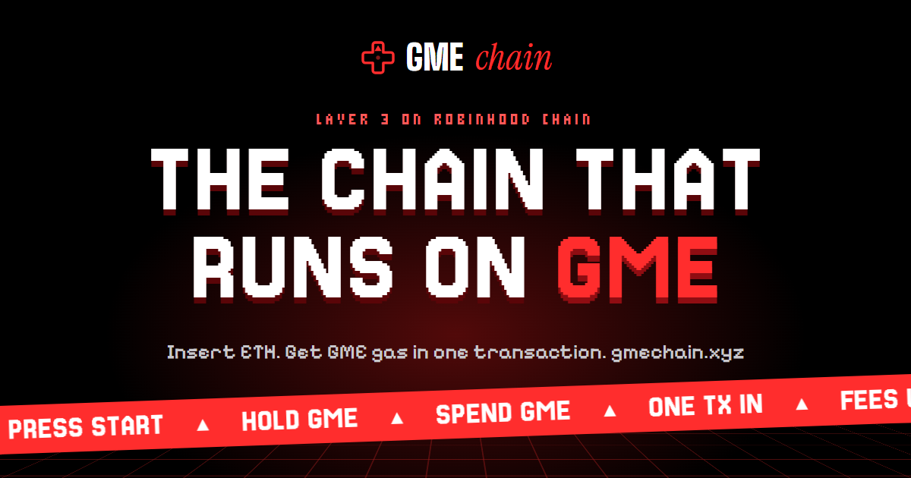
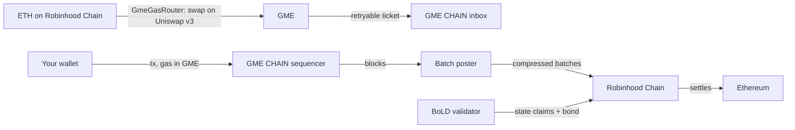

<p align="center">
  <a href="https://gmechain.xyz"></a>
</p>

<h1 align="center">GME CHAIN</h1>

<p align="center">
  An independent Arbitrum Layer 3 on Robinhood Chain where every fee is paid in the <b>GME Stock Token</b>.<br>
  Bring ETH: the bridge swaps it to GME and it arrives as gas, in one transaction.<br>
  <a href="https://gmechain.xyz">Website</a> ·
  <a href="https://gmechain.xyz/bridge/">Bridge</a> ·
  <a href="https://gmechain.xyz/docs/">Docs</a> ·
  <a href="https://gmechain.xyz/roadmap/">Roadmap</a> ·
  <a href="CHANGELOG.md">Changelog</a> ·
  <a href="https://gmechain.xyz/launch/">Launchpad</a> ·
  <a href="https://gmechain.xyz/stake/">Stake</a> ·
  <a href="https://x.com/GMEChainXYZ">X</a>
</p>

## $GMEC, the official token

| | |
|---|---|
| Contract | [`0xa8c53b1dAcFbd07895dC8D2c638F1bFDe10C0122`](https://robinhoodchain.blockscout.com/token/0xa8c53b1dAcFbd07895dC8D2c638F1bFDe10C0122) |
| Chain | Robinhood Chain (chain ID 4663) |
| Name / symbol | GME Chain / GMEC, 18 decimals |
| Trade | [FOMO](https://fomo.family/tokens/robinhood/0xa8c53b1dacfbd07895dc8d2c638f1bfde10c0122) · [Pons](https://ponsfamily.com/launchpad/0xa8c53b1dacfbd07895dc8d2c638f1bfde10c0122) |

This is the only $GMEC published by GME CHAIN, here and on [gmechain.xyz](https://gmechain.xyz). Other tokens using the GMEC ticker are not ours. Gas on GME CHAIN is always GME; $GMEC is used for [staking for gas credits](docs/staking-guide.md) and is bought back and burned from [exchange and launchpad fees](docs/fee-burn.md).

---

## What is GME CHAIN?

GME CHAIN is a blockchain built with Arbitrum Nitro. It runs as a **Layer 3**: it posts its data to **Robinhood Chain** (a Layer 2), which settles to **Ethereum**.

Its gas token is **GME**, the Robinhood Stock Token that tracks GameStop Corp. shares (NYSE: GME). Your wallet shows GME as your balance, and every transaction takes a small amount of it as the fee. You do not need to hold GME to start: the bridge takes ETH on Robinhood Chain, swaps it to GME on Uniswap v3 and deposits it, in one transaction. On the way out you claim GME on Robinhood Chain and can convert it back to ETH on the same page.

Everything else works like any EVM chain: MetaMask, Rabby, Foundry, Hardhat, viem and ethers all work unchanged.

> GME CHAIN is independent. It is not made, endorsed or sponsored by GameStop Corp., Robinhood Markets, Inc. or Offchain Labs. "GME" is the ticker of the token used as gas.

## Status

| Part | Status |
| --- | --- |
| **Testnet** (chain 12822): bridge, exchange, explorer, test kit faucet | **Live** at [gmechain.xyz](https://gmechain.xyz) |
| Mainnet (chain 12821): rollup, bridge with ETH, token bridge, exchange | Deployed and verified; the node runs and the validator is staked |
| Mainnet apps on the website | Open at launch |
| $GMEC, the GME CHAIN token | Not launched. Any token called GMEC today is not ours |

Until launch the website runs on testnet. Full roadmap: [docs/roadmap.md](docs/roadmap.md).

## The gas token, checked on chain

| | |
| --- | --- |
| Contract (Robinhood Chain, 4663) | [`0x1b0E319c6A659F002271B69dB8A7df2F911c153E`](https://robinhoodchain.blockscout.com/token/0x1b0E319c6A659F002271B69dB8A7df2F911c153E) |
| `name()` / `symbol()` / `decimals()` | `GameStop • Robinhood Token` / `GME` / `18` |
| Proxy | Beacon proxy to Robinhood's stock token beacon `0xe10b6f6b275de231345c20d14ab812db62151b00`; runtime bytecode byte-identical to every other Robinhood stock token |
| Deepest pool (price source) | Uniswap v3 GME/USDG 1% [`0xe9713f45…2fdf`](https://robinhoodchain.blockscout.com/address/0xe9713f453adb9245b19559790c96f470a18f2fdf) |
| ETH route | Uniswap v3 WETH/GME 0.05% [`0xc6bcc950…a607`](https://robinhoodchain.blockscout.com/address/0xc6bcc95043dc48c204bb2d57fb264a10efe0a607) |

Several unrelated tokens on Robinhood Chain call themselves "GameStop" or "GME" (for example `0xc2362a…` and `0x7e8638…`). They are not the stock token.

## Network details

| | Mainnet | Testnet |
| --- | --- | --- |
| Network name | GME CHAIN | GME CHAIN Testnet |
| Chain ID | `12821` (`0x3215`) | `12822` (`0x3216`) |
| RPC | `https://rpc.gmechain.xyz` | `https://rpc.testnet.gmechain.xyz` |
| Gas token | GME Stock Token | tGME (test, no value) |
| Parent chain | Robinhood Chain (4663) | Robinhood Chain Testnet (46630) |
| Settles to | Ethereum (through Robinhood Chain) | Ethereum (through Robinhood Chain) |
| Withdrawal wait | about 1 day | 1 to 2 hours |

All addresses: [docs/contracts.md](docs/contracts.md)

## How it works



1. **You bridge** ETH (or GME) from Robinhood Chain. [`GmeGasRouter`](chain/contracts/GmeGasRouter.sol) wraps the ETH, swaps it to GME with a 1% price limit, and opens a deposit ticket to your own address. No owner, no fee, no upgrade, and it never holds funds between transactions.
2. **You sign** transactions on GME CHAIN and pay gas in GME.
3. **The sequencer** orders them into blocks, usually within a second.
4. **The batch poster** posts compressed blocks to Robinhood Chain. It pays ETH there and is repaid in GME at a rate from Chainlink ETH/USD and the GME price ([`GmeFeeTokenPricer.sol`](chain/contracts/GmeFeeTokenPricer.sol)). The keeper feeds that price from the 30-minute TWAP of the deepest GME pool, checked against a second pool and an off-chain quote.
5. **A bonded validator** posts the resulting state. A wrong claim can be disputed during the challenge window (BoLD); at launch the validator allowlist is on, so only our validator can post or dispute claims.
6. **Ethereum** has the final say, through Robinhood Chain.

More: [docs/how-it-works.md](docs/how-it-works.md)

## Know the token you pay with

GME CHAIN does not issue GME and cannot change it. GME is issued by Robinhood Assets (Jersey) Limited as a tokenized debt security that tracks the share price; holders get price exposure, not shares or shareholder rights. It is not available to US persons and is restricted in several other places. Its issuer can **pause** transfers, **block** addresses (including our bridge), **burn** balances and **upgrade** the token contract. These powers apply to every chain that uses a Robinhood stock token as gas.

## Repository layout

```text
chain/        contracts, deploy scripts, node config, keeper, monitor, faucet, testnet pulse, fork rehearsal
  contracts/  GmeFeeTokenPricer, GmeGasRouter (bridge with ETH), WrappedGME, test tokens
  scripts/    numbered deploy steps (00 to 06), services, rehearsals, bytecode check
  test/       Foundry tests (unit, fuzz, and a fork test against Robinhood Chain mainnet)
site/         gmechain.xyz: home, bridge, swap, explorer, docs, roadmap (static)
walletkit/    source of the wallet modal (RainbowKit + wagmi); its build output is not committed
deploy/vps/   docker compose + Caddy for one VPS: website, RPCs, mainnet and testnet Nitro nodes, keeper,
              monitor, faucet, pulse
docs/         this documentation
```

### Run the website locally

```bash
cd walletkit && npm install && npm run build && cd ..   # builds site/js/walletkit and site/walletkit.css
cd site
python -m http.server 8765                              # then open http://127.0.0.1:8765
```

### Test the contracts

```bash
cd chain && npm ci && forge build
ROBINHOOD_RPC=https://robinhood.drpc.org forge test     # without ROBINHOOD_RPC the fork tests are skipped
npm run rehearse                                        # full mainnet deployment on a local fork; costs nothing
```

### Deploy

Chain: [chain/README.md](chain/README.md). Server: [docs/vps-guide.md](docs/vps-guide.md). Operator keys live in `.env.mainnet` / `.env`, which are never committed.

## Trust model

At launch one operator runs the sequencer, the batch poster and the validator. That is normal for a new Arbitrum chain and it is the main trust assumption to know about: the sequencer can delay or reorder transactions, and while the validator allowlist is on, withdrawals rely on the operator's validator posting honest state. Every batch is public on Robinhood Chain, so anyone can check it, and withdrawals wait for the challenge window. Chain ownership starts with the deployer key and is planned to move to a multisig.

## Security

Found a problem? Please do not open a public issue for anything that could put funds at risk. See [SECURITY.md](SECURITY.md).

## Transparency

Every contract, every operator wallet and what it can do, where fees go, and what is not in place yet: [TRANSPARENCY.md](TRANSPARENCY.md). Anyone can check that the code on chain is the code in this repository with `node chain/scripts/verify-bytecode.js` (CI runs it on every push).

## License

The code in this repository is released under the [MIT License](LICENSE), with these exceptions:

- [`chain/contracts/WrappedGME.sol`](chain/contracts/WrappedGME.sol) is a port of WETH9 and keeps its **GPL-3.0-or-later** license, as stated in the file.
- The wallet bundle (`site/js/walletkit/`, built locally and not committed) comes from RainbowKit, wagmi, viem, React and TanStack Query, each under its own license (MIT).
- The exchange contracts are the official Uniswap V2 bytecode, fetched from npm at deploy time and not stored here; they remain under Uniswap's licenses.
- The chain itself runs the official Arbitrum Nitro node and contracts from Offchain Labs, under their licenses.
- The GME market chart on the home page is an embedded TradingView widget.

## Disclaimer

GME CHAIN is independent and not affiliated with GameStop Corp., Robinhood Markets, Inc., Offchain Labs, Uniswap Labs or TradingView. Names are used only to describe the assets and technology involved. Nothing here is investment advice or an offer of securities. Tokenized stocks carry market, issuer and regulatory risk and are not available everywhere.
